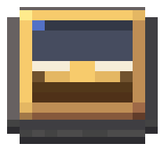
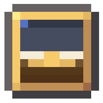

# Indicador de Atitude (item) — fonte visual (v1, ferro industrial + latão)

Item `attitude_indicator_module` no inventário, na mão e no chão. Guia obrigatório:
[guia visual v2.1](../../docs/visual-design-guide.md), seção 9. Segue a linguagem do
[FMS Compass](../fms-navigator/README.md) e do [módulo FMS](../fms-module-2x3/README.md). Os modelos que a
mesa desenha (cunha e placa) continuam em [`attitude-indicator-module`](../attitude-indicator-module/README.md);
este é o objeto que o jogador carrega.

Abra `attitude_indicator_item.bbmodel` no Blockbench (Java Block/Item, 1.21.1, *Box UV* desligado, resolução 32×32).
Modelado deitado, como o compasso: apoio em Y = 0, centrado em X/Z = 8, norte em Z baixo (topo do ícone).




## Por que existe

O item herdava o modelo da cunha da mesa (10×12×10, tela de pé). No inventário ele aparecia de trás, como uma
caixa de ferro escura, sem a tela. O FMS e o FMS Compass não têm esse problema: o FMS é visto de cima e o compasso
é um objeto próprio. Agora o Indicador de Atitude também é um objeto próprio.

## Identidade

- **Um medidor de bolso:** placa de ferro industrial 12×12 com cantos chanfrados de 1 unidade (três placas, como o
  disco do compasso) e um degrau de latão por cima. Sem orelhas nem alças: a silhueta é a placa chanfrada.
- **Lê como horizonte artificial:** lente 8×8 (o mesmo tamanho da lente do módulo da mesa) com céu em cima (rampa da
  lente escura, reflexo azul no canto), terra de madeira embaixo, linha de horizonte de pergaminho e o símbolo da
  aeronave em latão atravessando a linha. É o que o separa do FMS Compass (disco redondo com ponteiro diagonal) e do
  FMS (tela escura, dois knobs) mesmo a 16 px.
- **Só paleta:** nenhum pixel fora das rampas do guia (§5). O azul do céu real do display é exceção de display
  (§9.4); aqui o céu usa a rampa da lente.
- **No inventário** aparece chapado de cima, como o compasso (`gui_light: front`).

## Peças

| Elemento | Volume | Material |
| --- | --- | --- |
| `case` | `[2,0,3]–[14,2,13]` | topo: recorte da face pintada; laterais e fundo: `create:block/industrial_iron_block` |
| `case_north`, `case_south` | `[3,0,2]–[13,2,3]`, `[3,0,13]–[13,2,14]` | idem (cantos chanfrados) |
| `bezel` | `[3,2,3]–[13,3,13]` | latão; topo 10×10 com a lente 8×8 pintada |

Quatro cubos, coordenadas inteiras, sem rotação, sem faces coplanares. As faces que encostam numa placa vizinha ficam
desativadas (`texture: null`).

## Texturas (1 texel = 1 unidade)

`attitude_indicator_item.png`, atlas **32×32**: topo da placa 12×12 em `[0,0]` (só o contorno de 1 px fora do degrau
aparece), topo do degrau 10×10 em `[12,0]`, lados do degrau (claro e sombra) 10×1 em `[12,10]` e `[12,11]`. A carcaça usa `create:block/industrial_iron_block` por id (linhas 14–16, com a borda escura);
nenhum pixel do Create é copiado.

## Exportação

```powershell
node blockbench/attitude-indicator-item/export-assets.mjs
node blockbench/attitude-indicator-item/render-preview.mjs
```

Gera `models/block/attitude_indicator_item.json` e o PNG. `models/item/attitude_indicator_module.json` herda o
modelo e define as transformações de exibição e os overrides de `custom_model_data`: **1** = placa e **2** = cunha. A
Mesa Modular pede esses dois (`ModularTableRenderer`), e é por isso que o item padrão pode ser outro objeto.
`create-base-model.mjs` é só o bootstrap: não o rode sobre uma fonte já refinada no Blockbench.

## Mudou a geometria?

`AttitudeIndicatorAssetsTest` (`itemModelIsAFlatGaugeInTheCompassLanguage`, `itemAtlasIs32SquareAndOpaque` e o teste
dos overrides). A colisão não muda: o item não é bloco.

## Pendente

- Refino no Blockbench: a fonte atual é a do bootstrap e ainda não foi aberta no Blockbench.
- Validação no jogo: inventário (16 px), mão em primeira e terceira pessoa, chão e moldura de item. As transformações
  foram copiadas do compasso e **não foram vistas no jogo**; só há render local de software (`preview*.png`).
- Conferir no jogo se o símbolo de latão ainda se lê a 16 px ou se vira uma mancha única; se virar, afinar o desenho da
  lente.
