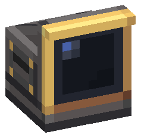
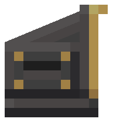
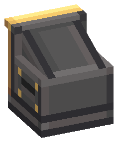
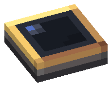
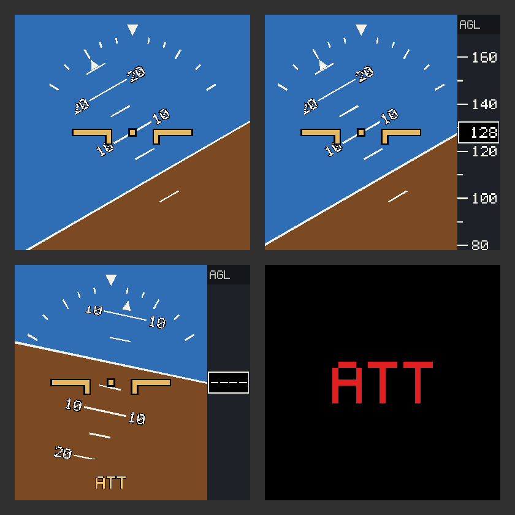

# Indicador de Atitude 2×2 — fonte visual (v3, ferro industrial pintado + latão polido)

Guia obrigatório: [guia visual v2.1](../../docs/visual-design-guide.md), seção 9. Plano completo:
[attitude-table-module-plan](../../docs/attitude-table-module-plan.md). Mesmas linhas do
[Avionics Computer](../avionics-computer/README.md) e do [FMS](../fms-module-2x3/README.md): ferro industrial pintado
(bisel claro em cima e à esquerda, aro escuro; rebites de latão e veneziana só nas laterais), tela de lente escura numa moldura de latão
polido de 1 px, viseira de latão que sobe 1 unidade. Referências: navigation table do Simulated, gauges do Create.

**Estado: só visual.** Modelos, textura, registro do item, colocação na mesa e um display com valores
mockados. Nada lê o ARU nem o Radar Altimeter ainda (ver *Pendente*).

**O item no inventário não é mais este modelo:** ele é um medidor de bolso próprio
([`attitude-indicator-item`](../attitude-indicator-item/README.md)). A cunha e a placa só são desenhadas pela mesa,
que as pede ao item por `custom_model_data` (2 = cunha, 1 = placa).

Dois modelos, escolhidos pela face da mesa (`FACING == UP` → cunha; parede e teto → placa). Fonte em
Blockbench (Java Block/Item, 1.21.1, *Box UV* desligado, resolução 32×32): abra `attitude_indicator_desk.bbmodel`
e `attitude_indicator_wall.bbmodel`. Modelados com a mesa voltada para cima: apoio em Y = 0, centro em X/Z = 8,
carcaça 10×10 (eixo de 2 células).






## Identidade

- **Material:** ferro industrial **pintado** no atlas (rampa `n`–`W`, como o Avionics Computer; o
  `create:block/industrial_iron_block` fica só como partícula) + latão polido (moldura, lábio da tela, viseira, aro da
  placa: rampa 8/7 na luz, 4/3/2 na sombra) + lente escura. Sem madeira.
- **Cunha:** caixa de ferro com tampo inclinado subindo da traseira (y 8) até a tela, que fica **de pé** na frente
  (lado do piloto, +Z). O tampo é 1 unidade mais estreito de cada lado: deixa um ressalto de 1 sobre a carcaça e
  nenhuma face coplanar. Viseira de latão 1 unidade à frente sobre a tela. Sem botões nem knobs: o módulo não tem controle
  físico.
- **Encaixe da tela (v3):** as laterais, o topo e a traseira do cubo da tela são de ferro, com só o lábio da frente em
  latão. A moldura lê como embutida na caixa de ferro, e não como uma placa de latão colada nela. Um plinto de 2 sob
  tudo substitui o pé solto da v2.
- **Altura 12:** com a mesa de 4, o topo da tela encosta no topo do bloco. Não invade mais o bloco de cima (a v1 3×3
  tinha 16).
- **Placa:** casca fina e reta (3 de altura), tela no topo, para mesas de parede e teto, igual ao FMS.
- **Área ativa:** lente 8×8 nos dois modelos; o display é o mesmo.

### O que mudou da v1 (3×3)

A v1 tinha a moldura em 4 barras soltas e uma lente só com a face da frente; o tampo girado terminava antes da
tela e a escada debaixo dele não chegava até o tampo. Pela fresta, o display (desenhado sem cull) aparecia por trás
do bloco. Na v2 a tela é **um cubo sólido** com todas as faces e a moldura pintada, o tampo tem 4 de espessura (a
face de baixo e a traseira ficam enterradas na carcaça, a ponta da frente dentro da tela) e não há escadas.

## Peças

Cunha (5 cubos):

| Elemento | Volume | Material |
| --- | --- | --- |
| `base` | `[3,0,3]–[13,2,13]` | ferro pintado; plinto sob a carcaça e a tela (borda clara em cima, aro escuro embaixo) |
| `housing` | `[3,2,3]–[13,8,11]` | ferro pintado: laterais com bisel, rebites de latão e uma veneziana; traseira lisa, só com bisel |
| `housing_slope` | `[4,4,3]–[12,8,12]`, girado **−22,5° em X**, origem `[8,8,3]` | ferro pintado liso, só com bisel; sobe da traseira (y 8) até y ≈ 11,3 na tela; faces de baixo, de trás e da frente enterradas (desligadas) |
| `screen` | `[3,2,11]–[13,12,13]` | frente 10×10: moldura de latão polido de 1 px + lente 8×8 (`X 4–12`, `Y 3–11`, face em z 13); laterais, topo e traseira de ferro com o lábio da frente em latão |
| `visor` | `[3,11,13]–[13,12,14]` | latão; aba contra o sol |

Placa (2 cubos):

| Elemento | Volume | Material |
| --- | --- | --- |
| `housing` | `[3,0,3]–[13,2,13]` | ferro pintado (mesma faixa do plinto da cunha) |
| `screen` | `[3,2,3]–[13,3,13]` | topo 10×10: moldura de latão polido de 1 px + lente escura 8×8; aro de latão claro (`7`) nos lados da luz, `4` nos da sombra |

## Texturas

`attitude_indicator_module.png`, atlas **32×32**, compartilhado pelos dois modelos, 100% na paleta. Regiões em `UV`
do `create-base-model.mjs`: frente, traseira, topo e laterais da tela, topo e laterais do tampo, painéis da carcaça
(lateral 8×6, traseira 10×6), bordas visíveis do topo da carcaça, faixa do plinto, fundo, faces da viseira e bordas
da placa. Até a v2 a carcaça era recorte cru de `create:block/industrial_iron_block`; o recorte emendava mal entre
cubos e não tinha bisel, por isso a v3 pinta o ferro no atlas como o Avionics Computer.

## O display

Não é textura: é geometria desenhada em tempo real pelo `ModularTableRenderer`
(`AttitudeDisplayRenderer`), unlit, em um passe plano como a bússola do FMS. Exceção de display da seção 9.4
do guia. Layout v2 (2026-11-07) em `AttitudeDisplayLayout`, numa grade de 48 pixels de display (`DP`) na lente:
céu e solo com linha de horizonte, escada de pitch sem números (linhas a cada 10°), índice de bank com marcas em
30° e 60° e ponteiro que gira com o roll, símbolo da aeronave em latão com contorno chumbo, e uma faixa embaixo com
velocidade (`b/s`) e altura AGL (`b`) em números de até 3 dígitos, com as unidades numa fonte 3×5 menor. Sem a
faixa, o horizonte ocupa a tela toda. Bandeira `ATT` vermelha sem dados e âmbar em degradado.

**Dia e noite:** de dia, céu azul claro dos schematics do Create (`#9FB0E8`), solo `#876438` e marcas chumbo
(`#2B2D33`); à noite, céu ardósia da lente do item (`#464C5F`), solo `#3B2814` e marcas creme (`#F6EDD8`). Céu e solo
se misturam no crepúsculo pelo escurecimento do céu (`getSkyDarken`); as marcas trocam de uma vez no meio. Em
dimensões sem céu a tela fica sempre na paleta da noite. Escurece as cores, não o brilho: o display continua unlit.

**Velocidade fictícia (TEMPORÁRIO):** não há sensor de velocidade. O feed liga a faixa de velocidade sempre e a
preenche com `AttitudeDisplayMock.speed()`, para testar o layout no jogo.



Para gerar a imagem:

```powershell
$env:FBI_WRITE_PREVIEW = "$PWD\blockbench\attitude-indicator-module\display-preview.png"
.\gradlew.bat test --tests "*AttitudeDisplayLayoutTest"
```

## Exportação

```powershell
node blockbench/attitude-indicator-module/export-assets.mjs
node blockbench/attitude-indicator-module/render-preview.mjs
```

O exportador falha com cubo rotacionado (exceto `housing_slope`, só −22,5° em X), coordenada fracionária ou
densidade diferente de 1:1. A fonte da cunha é dona do PNG; a da placa precisa ter os mesmos pixels. **Não rode
o `create-base-model.mjs` sobre uma fonte já refinada no Blockbench.**

## Mudou a geometria?

`PanelCoordinates.moduleTop(type, facing)` / `DISPLAY_HEIGHT` (volume de seleção: vai até o topo do bloco só na
mesa de chão; na de parede e teto a placa usa o volume comum, que até a v2 saía 12 unidades para fora), as constantes da lente em
`AttitudeDisplayRenderer` (`LENS_FACE_WEDGE`, `WEDGE_CENTER_Y`, `LENS_FACE_PLATE`, `LENS`) e
`AttitudeIndicatorAssetsTest`. Ao mexer no tampo, confira que a face de baixo continua dentro da carcaça e a ponta
dentro da tela (perfil em `preview-side.png`): é o que impede frestas.

## Pendente

- Nenhum dado real: o display roda no mock. Falta ligar ao ARU mais próximo da rede e ao Radar Altimeter
  (AGL), com interpolação por `ClientSubLevel.renderPose` e o alinhamento de ~1 s ao ligar.
- Configuração (fita de altitude liga/desliga, velocidade "em breve") e rotação (`yaw`) da cunha: hoje a cunha
  olha sempre para o lado +Z do painel.
- Receita. O item é Experimental, só no criativo. Ponder: cenas `attitude_indicator` e `attitude_sources` em
  `FbiPonderScenes` (usam o módulo real do jogo; reconfira o diorama se a geometria mudar).
- Velocidade: sem sensor. A faixa mostra um valor fictício (ver *O display*); tirar os pontos `TEMPORARY` quando
  houver fonte real.
- Não verificado no jogo: a v2 2×2 inteira (ausência de frestas por trás, cunha nos 4 sentidos, mesa de parede e
  teto, colocação 2×2 atravessando mesas unidas, transformações do item na GUI e na mão), shaders (Complementary,
  BSL) e sol forte, FPS com vários displays. Geometria só conferida em render local de software.
- As unidades `b/s` e `b` têm ~0,4 texel de altura no jogo; conferir se leem a 2–3 blocos.
- Refino de pixels no Blockbench: a fonte v3 é a do bootstrap e ainda não foi aberta no Blockbench.
