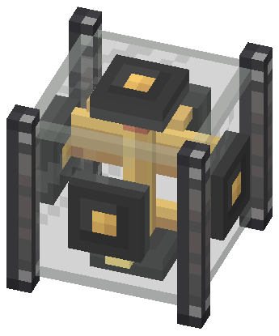
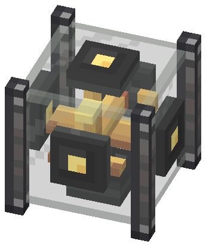

# Attitude Reference Unit — fonte visual (v4, aviãozinho no vidro)

Guia obrigatório: [guia visual v2.1](../../docs/visual-design-guide.md), com a convenção de
[faces configuráveis por blockstate (§8.7)](../../docs/visual-design-guide.md#87-faces-configuráveis-por-blockstate).
Plano do bloco: [attitude-reference-unit-plan.md](../../docs/attitude-reference-unit-plan.md).
Referências diretas: industrial iron block (Create), modelo de avião de mesa em latão, nixie tube (vidro).

Abra `attitude_reference_unit.bbmodel` no Blockbench (Java Block/Item, 1.21.1, *Box UV* desligado).

  
  

**Estado: no código, sem validação no jogo.** `export-assets.mjs` gera os modelos e o blockstate a partir deste
`.bbmodel`; `render-preview.mjs` desenha os previews dos modelos exportados (hélice em repouso). Testes em
`AttitudeReferenceUnitAssetsTest`. Rode `node blockbench/attitude-reference-unit/export-assets.mjs` após editar a fonte.
`create-base-model.mjs` é só o bootstrap: não rode sobre a fonte refinada.

## Identidade

Um **modelo de avião de latão numa caixa de vidro**: o nariz aponta para a face Nariz e a deriva para a face Acima,
nas 24 orientações. Substitui as hastes e o gimbal do v3, que mal apareciam atrás dos sockets.

| Pista | Attitude Reference Unit |
| --- | --- |
| Material dominante | Vidro translúcido + ferro industrial (`create:block/industrial_iron_block`); avião de latão |
| Silhueta | Cubo de vidro com 4 postes de 2×16×2 nas quinas, sem aros horizontais |
| Nariz | **Cone de cobre** na ponta da fuselagem, atrás da hélice |
| Acima | **Deriva** com a ponta clara de latão; o **suporte** (haste + base) sai da face oposta |
| Hélice | Uma pá de metal escuro com pontas de latão, girando no eixo do nariz (block entity renderer, 24°/tick) |
| Sockets | 6×6×2 de metal escuro no centro de cada parede; o miolo 2×2 é a **luz de status** |

A fonte mostra a colocação padrão: **Nariz = NORTH, Acima = UP**. Não há redstone.

### Luz de status (propriedade `status`)

| `status` | Leitura | Miolo do socket |
| --- | --- | --- |
| `ok` | `VALID` ou `GROUND` | latão claro, fixo |
| `degraded` | `DEGRADED` (perto de ±90° de pitch) | âmbar piscando (`frametime` 6) |
| `inop` | `UNAVAILABLE` | vermelho redstone piscando (`frametime` 4) |

Mesma técnica da tela do Avionics Computer (guia §9.4): textura animada vanilla trocada pelo blockstate, mesma
geometria. Os três modelos `frame_*` só diferem na textura `socket_*`.

## Peças (19 cubos)

Todas as coordenadas são inteiras, sem rotação. Os sockets entram 2 unidades no bloco, então o avião vive em
`2..14` em todos os eixos (o plano previa a hélice em `z 1–2` e a base em `y 1–2`, que ficariam dentro dos sockets).

| Grupo / modelo | Elementos | Material |
| --- | --- | --- |
| `frame` → `_frame_ok/_degraded/_inop` | `post_nw/ne/sw/se` 2×16×2; `socket_<lado>` ×6, 6×6×2 | Ferro industrial (Create, por id); metal escuro; miolo de status |
| `glass` → `_glass` (translucent) | `glass` `[1,1,1]–[15,15,15]` | Vidro 16×16 |
| `airplane` → `_airplane` e `_airplane_rolled` | `fuselage` 2×2×10 `z 4–14`; `nose_cone` 2×2×1 `z 3–4`; `wing` 12×1×4 `y 6–7`; `stabilizer` 8×1×2; `fin` 2×4×3 `y 9–13`; `stand_rod` 2×3×2; `stand_base` 6×1×6 `y 2–3` | Latão; cobre no cone; metal escuro no suporte |
| `propeller` → `_propeller` | `propeller` 8×2×1 `z 2–3` | Metal escuro, pontas de latão |
| tudo → `_item` | modelo do inventário, hélice em repouso, `render_type: translucent` | — |

Asa baixa (`y 6–7`, sob a fuselagem) e deriva sobre a fuselagem: nenhuma face coplanar sobreposta.

### As 24 orientações

As rotações `x`/`y` do blockstate levam um modelo rígido a só 16 das 24 orientações; faltam as 8 em que Nariz e Acima
são ambos horizontais. O exportador gera `_airplane_rolled`: a mesma fonte rolada 90° no eixo do nariz
(`(x, y, z) → (y, 16 − x, z)`, Acima = EAST), com as faces remapeadas e a rotação de UV que mantém cada texel no mesmo
canto. O blockstate tem uma entrada por par `(nose, up)` válido, escolhida por busca no exportador. A hélice não entra
no blockstate: o renderer a posiciona por `AttitudeOrientation.rotation()`.

## Texturas (1 texel = 1 unidade)

- `attitude_reference_unit_parts.png` (32×32): uma região por (material, tamanho) de face, mais os mapas escritos à mão
  da asa, do estabilizador, da deriva e da hélice (`create-base-model.mjs`). Também é a partícula.
- `attitude_reference_unit_socket_ok.png` (16×16), `_socket_degraded.png` e `_socket_inop.png` (16×32, 2 quadros, com
  `.mcmeta`): a face 6×6 do socket em `[0,0,6,6]`. Só o miolo 2×2 muda entre elas.
- `attitude_reference_unit_glass.png` (16×16, **único com alpha**): alpha baixo e uniforme, borda mais clara, reflexo
  diagonal em cima à esquerda; as faces usam a região `[0,0,14,14]`.
- Postes: `create:block/industrial_iron_block` referenciada por id (cópia local em `reference/create-textures/`, fora do git).

Cores: 100% da paleta (metal escuro, latão, cobre, redstone) mais o vidro, feito com o tom claro do andesito em alpha.

## Gerar e renderizar

```powershell
node blockbench/attitude-reference-unit/create-base-model.mjs   # só o bootstrap; não rode sobre fonte refinada
node blockbench/attitude-reference-unit/export-assets.mjs       # modelos, blockstate, texturas; apaga os modelos antigos
node blockbench/attitude-reference-unit/render-preview.mjs      # previews dos modelos exportados
```

## Mudou a geometria?

`SHAPE` em `AttitudeReferenceUnitBlock` (glass + 4 postes + 6 sockets; o avião fica dentro do vidro e não entra),
`cableSocket` (socket no centro de cada face), o renderer `AttitudeReferenceRenderer` (pivô em 8,8,8, eixo do nariz)
e `AttitudeReferenceUnitAssetsTest`. Os nomes `fuselage`, `nose_cone`, `fin` e `stand_base` são contrato com o teste.

## Verificado

- Exportador e previews rodam sem erro; previews conferidos a olho (padrão, faca, nariz para cima, traseira).
- `AttitudeReferenceUnitAssetsTest` e `AttitudeOrientationTest`: nas 24 orientações o cone cai na face Nariz, a deriva
  na face Acima e o suporte na face oposta; cada `(nose, up, status)` resolve um avião, um frame e o vidro.

## Pendente

- **Nada disto foi visto no jogo.** Conferir: colocação padrão; wrench em cada face; as 24 orientações pela tela;
  hélice girando dentro e fora de sublevel; status (fora de sublevel = `ok`, perto de ±90° = `degraded`); tooltip dos
  Goggles; item no inventário; Ponder `attitude_unit`; vidro e postes entre casings do Create; com shader.
- **Legibilidade a ~5 blocos:** no preview pequeno o avião vira uma mancha de latão; os sockets 6×6 cobrem o centro
  de cada face e só deixam ver as pontas da asa, o nariz e a cauda. De perto lê como avião. Se no jogo não bastar,
  a saída é reduzir o socket visível (mexe no contrato do conector), não o avião.
- **`inop` quase não aparece:** a leitura só é `UNAVAILABLE` antes do primeiro tick do servidor.
- A luz de status é um miolo 2×2 por face: a âmbar se distingue da `ok` mais pelo piscar do que pela cor.
- Refino no Blockbench (a fonte ainda é a saída do bootstrap) e abertura do arquivo lá.
- O `.bbmodel` não anima a hélice; a rotação de UV da variante rolada foi conferida só pelo render local.
