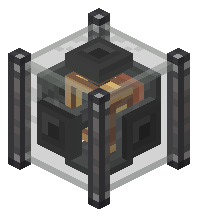
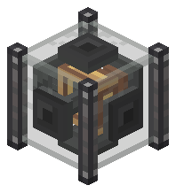
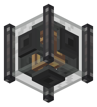
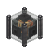

# Attitude Reference Unit — fonte visual (v3, vidro + ferro industrial)

Guia obrigatório: [guia visual v2.1](../../docs/visual-design-guide.md), com a convenção de
[faces configuráveis por blockstate (§8.7)](../../docs/visual-design-guide.md#87-faces-configuráveis-por-blockstate).
Plano do bloco: [attitude-reference-unit-plan.md](../../docs/attitude-reference-unit-plan.md).
Referências diretas: industrial iron block (Create), horizonte artificial real visto por dentro, nixie tube (vidro).

Abra `attitude_reference_unit.bbmodel` no Blockbench (Java Block/Item, 1.21.1, *Box UV* desligado).

   

**Estado: no código, sem validação no jogo.** `export-assets.mjs` gera os modelos e o blockstate a partir deste
`.bbmodel`; `render-preview.mjs` desenha os previews dos modelos exportados (gimbal em repouso). Testes em
`AttitudeReferenceUnitAssetsTest`. Rode `node blockbench/attitude-reference-unit/export-assets.mjs` após editar a fonte.
`create-base-model.mjs` é só o bootstrap: não rode sobre a fonte refinada.

## Identidade

Um **horizonte artificial por dentro**: cubo de vidro, 4 postes verticais slim de ferro industrial nas quinas e um
gimbal no centro. Só as duas **hastes de referência** dependem da configuração; cada uma tem uma ponta diferente da outra.

| Pista | Attitude Reference Unit |
| --- | --- |
| Material dominante | Vidro translúcido + ferro industrial (`create:block/industrial_iron_block`); latão no gimbal |
| Silhueta | Cubo de vidro com 4 postes de 2×16×2 nas quinas, sem aros horizontais |
| Haste do Nariz | Bulbo **cobre** 4×4×2 na frente; tampa lisa 2×2 atrás. Aponta para a face Nariz |
| Haste do Acima | Bulbo **latão** 4×4×2 em cima; tampa lisa 2×2 embaixo. Aponta para a face Acima |
| Gimbal | Anel de latão que balança ±14° em Y e volante que gira em Z, em loop (block entity renderer) |
| Sockets | Anel 4×4×1 de metal escuro no centro de cada parede, por fora do vidro |

A fonte mostra a colocação padrão: **Nariz = NORTH, Acima = UP**. Distinção das hastes: cor (cobre × latão) e
posição; não há redstone (a propriedade `powered` saiu).

## Peças (23 cubos, divididos em modelos pequenos)

Passa de 20 elementos no total (guia §3 pede justificativa): cada modelo exportado tem ≤ 10, o vidro tem 1, e o gimbal
são 6 cubos que o renderer move. Todas as coordenadas são inteiras, sem rotação.

| Grupo / modelo | Elementos | Material |
| --- | --- | --- |
| `frame` → `_frame` | `post_nw/ne/sw/se` 2×16×2; `socket_<lado>` ×6, 4×4×1 | Ferro industrial (Create, por id); metal escuro |
| `glass` → `_glass` (translucent) | `glass` `[1,1,1]–[15,15,15]` | Vidro 16×16 |
| `arm_nose` → `_arm_nose` (frente em NORTH) | `nose_bulb` `[6,6,1]–[10,10,3]`, `nose_front` 2×2×1, `nose_rear` `z 12–15` | Cobre; metal escuro |
| `arm_up` → `_arm_up` (frente em UP) | `up_bulb` `[6,13,6]–[10,15,10]`, `up_front` 2×1×2, `up_rear` `y 1–4` | Latão; metal escuro |
| `gimbal_ring` → `_gimbal_ring` | 4 barras de um anel 8×8, 4 de profundidade, plano XY | Latão |
| `gimbal_rotor` → `_gimbal_rotor` | eixo 2×2×8 em Z e volante 4×4×2 | Metal escuro, marca de latão |
| tudo → `_item` | modelo do inventário, gimbal em repouso, `render_type: translucent` | — |

As hastes terminam no anel (x/y em 4 e 12) ou no eixo (z em 4 e 12), então nada se sobrepõe em nenhuma orientação.
O blockstate aplica `frame` e `glass` sempre, `arm_nose` por `nose` e `arm_up` por `up` (rotações `x`/`y`).

## Texturas (1 texel = 1 unidade)

- `attitude_reference_unit_parts.png` (32×32): uma região por (material, tamanho) de face, em empacotamento
  determinístico (`create-base-model.mjs`); sockets e volante têm mapa próprio. Também é a partícula.
- `attitude_reference_unit_glass.png` (16×16, **único com alpha**): alpha baixo e uniforme, borda mais clara, reflexo
  diagonal em cima à esquerda; as faces usam a região `[0,0,14,14]`.
- Postes: `create:block/industrial_iron_block` referenciada por id (cópia local em `reference/create-textures/`, fora do git).

Cores: 100% da paleta (metal escuro, latão, cobre) mais o vidro, feito com o tom claro do andesito em alpha.

## Gerar e renderizar

```powershell
node blockbench/attitude-reference-unit/create-base-model.mjs   # só o bootstrap; não rode sobre fonte refinada
node blockbench/attitude-reference-unit/export-assets.mjs       # modelos, blockstate, texturas; apaga os modelos v2.1
node blockbench/attitude-reference-unit/render-preview.mjs      # previews dos modelos exportados
```

## Mudou a geometria?

`SHAPE` em `AttitudeReferenceUnitBlock` (glass + 4 postes + 6 sockets), `cableSocket` (socket no centro de cada face,
1 unidade para dentro), o renderer `AttitudeReferenceRenderer` (pivôs em 8,8,8) e `AttitudeReferenceUnitAssetsTest`.

## Pendente

- **Nada disto foi visto no jogo.** Conferir: vidro e postes entre casings do Create; as 24 orientações; a leitura
  das pontas (cobre × latão) a ~5 blocos; o gimbal em loop (anel e volante sem atravessar as hastes nem o anel); o item
  no inventário; dentro de um sublevel; com shader.
- Refino no Blockbench (a fonte ainda é a saída do bootstrap) e abertura do arquivo lá.
- Vidro com alpha parcial é exceção nova ao guia §4/§9.4 (antes só a lâmpada); proposta registrada no guia.
- O BER desenha só o gimbal; o `.bbmodel` não o anima.
