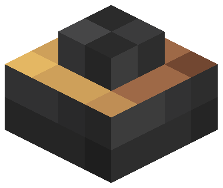
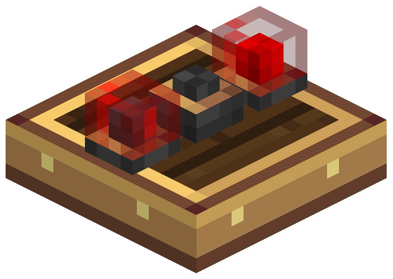

# Módulo de buzzer 1×1 — fonte visual (v2.1)

Guia obrigatório: [guia visual v2.1](../../docs/visual-design-guide.md), seção 9 (módulos da
mesa). Mesma família da [lâmpada 1×1](../lamp-module-1x1/README.md): metal escuro com aro de
latão.

Abra `buzzer_module_1x1.bbmodel` no Blockbench (Java Block/Item, 1.21.1, *Box UV* desligado,
resolução 32×32). Modelado com a mesa voltada para cima: apoio em Y = 0, centro em X/Z = 8.





## Identidade

- **Carcaça** quadrada de metal escuro, iluminada em cima à esquerda, com a aresta inferior
  no tom mais escuro.
- **Aro de latão** de 1 px no topo da carcaça, em volta da tampa.
- **Tampa em degrau** com a grade de furos pintada (pixels escuros alternados): lê como
  alto-falante sem as facetas rotacionadas do v1.

## Peças

| Elemento | Volume | Faces |
| --- | --- | --- |
| `housing` | `[6,0,6]–[10,2,10]` | laterais 4×2, topo 4×4 (aro), fundo 4×4 |
| `grille_cap` | `[7,2,7]–[9,3,9]` | laterais 2×1, topo 2×2 (grade); sem face `down` |

Dois cubos, coordenadas inteiras, sem rotação. Carcaça de 4×4×3: mesmo footprint da lâmpada
1×1 e 1 unidade mais baixa (guia, seção 9.2).

## Textura (1 texel = 1 unidade, 16×16)

`buzzer_module.png`, opaca, 100% da paleta (metal escuro e latão):

| Região | UV |
| --- | --- |
| Lateral da carcaça | `[0,0]–[4,2]` |
| Topo da carcaça (aro) | `[4,0]–[8,4]` |
| Fundo da carcaça | `[8,0]–[12,4]` |
| Lateral da tampa | `[0,4]–[2,5]` |
| Topo da tampa (grade) | `[2,4]–[4,6]` |

## Exportação

```powershell
node blockbench/buzzer-module-1x1/export-assets.mjs
node blockbench/buzzer-module-1x1/render-preview.mjs
```

Gera `models/block/buzzer_module_1x1.json` e `buzzer_module.png`. Falha com rotação,
coordenada fracionária ou face fora de 1:1. `create-base-model.mjs` é só o bootstrap: não o
rode sobre uma fonte já refinada no Blockbench.

O modelo de item (`models/item/buzzer_module.json`) herda o bloco, com as mesmas
transformações da lâmpada. O `ModularTableRenderer` desenha os quads crus do modelo no passe
cutout.

Mudou a geometria? Rode `BuzzerModuleAssetsTest` e confira a altura do emissor de som em
`PanelSpatial` (topo da tampa, 3 unidades acima da mesa) e `PanelCoordinatesTest`.

## Histórico

- **v1:** cilindro de 16 facetas a 22,5°, ~2,85 × 1,9 unidades, coordenadas fracionárias,
  quatro texturas 64×64 esticadas em preto piano (fora da paleta).
- **v2.1 (2026-10-29):** carcaça quadrada 4×4×3 com tampa em degrau, atlas 16×16. Cerca de
  40% maior que o v1 na largura.

## Pendente

- Refino de pixels no Blockbench: a fonte atual é a do bootstrap.
- Validação no jogo: mesa no chão, parede e teto, a 1 bloco, transformações de item e
  shaders. Os `preview*.png` são renders locais simplificados, sem AO.
