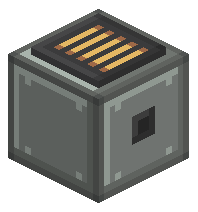
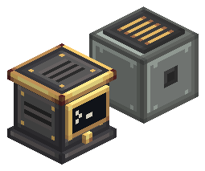

# Network Bridge — fonte visual (v2.1, liga de andesito + metal escuro e latão)

Guia obrigatório: [guia visual v2.1](../../docs/visual-design-guide.md). Referências diretas:
andesite alloy e andesite casing (Create), placas de metal das peças do Aeronautics.

Abra `network_bridge.bbmodel` no Blockbench (Java Block/Item, 1.21.1, *Box UV* desligado).

 

## Identidade

A bridge é o gateway do CC:Tweaked para a rede aviônica. É uma caixa de metal limpa, sem
peças salientes; os detalhes são só pintados e discretos. Para não ser confundida com o Avionics Computer:

| Pista | Avionics Computer | Network Bridge |
| --- | --- | --- |
| Material dominante | Ferro industrial (grafite), latão no acabamento | Liga de andesito (cinza-esverdeado claro) |
| Silhueta | Faixas horizontais: rodapé, corpo recuado, tampa | Um volume só, liso |
| Peça funcional | Uma tela na frente (NORTH) | Placa de metal escuro no topo com uma grade fina de cinco ranhuras de latão |
| Laterais | Venezianas horizontais escuras e socket | Painel liso com rebites; duas laterais opostas têm também um socket de dados 4×4 pequeno no centro |

- **Redstone:** não há saída de redstone.
- **Orientação:** `axis` (`x`/`z`, `BlockStateProperties.HORIZONTAL_AXIS`). Os sockets ficam de
  frente para quem coloca o bloco: na fonte estão em NORTH e SOUTH (`axis=z`); `axis=x` gira 90°.

## Peças

| Elemento | Volume | Material |
| --- | --- | --- |
| `box` | `[0,0,0]–[16,15,16]` | Liga de andesito: aro escuro, bisel claro em cima e à esquerda, escuro embaixo e à direita. Rebites nas quatro laterais; NORTH/SOUTH com um socket de dados 4×4 (anel de metal escuro, poço mais escuro) no centro |
| `plate` | `[2,15,2]–[14,16,14]` | Metal escuro com cinco ranhuras de latão de 1 px. 12×12 = 56% do topo |

Dois cubos, coordenadas inteiras, sem rotação. A caixa para 1 abaixo do topo para a placa ficar
rente ao limite do bloco: um Wire Connector no topo assenta na placa, e a haste de 2 px dele
alcança a caixa por qualquer face.

## Texturas (1 texel = 1 unidade)

- `network_bridge.png` (32×32), a única textura: lateral lisa 16×15 em `[0,0]`, topo e fundo da
  caixa 16×16 em `[16,0]`, lateral com socket 16×15 em `[0,16]`, placa 12×12 em `[16,16]`, bordas da placa 12×1 em `[16,28]`
  (clara) e `[16,29]` (escura). Também é a partícula.

100% dos pixels estão na paleta (andesito, metal escuro, latão).

A grade de latão aparece só no topo. Ela não se repete nas laterais (decisão de 2026-10-28).

## Exportação

Salve o `.bbmodel` com as texturas incorporadas. Depois, na raiz do mod:

```powershell
node blockbench/network-bridge/export-assets.mjs
node blockbench/network-bridge/render-preview.mjs
```

`create-base-model.mjs` é só o bootstrap: não o rode sobre uma fonte já refinada no Blockbench.

## Mudou a geometria?

Atualize `SHAPE` em `NetworkBridgeBlock` e rode `NetworkBridgeAssetsTest` (regras do guia, nomes
dos cubos, placa centrada e rente ao topo, laterais detalhadas no eixo do blockstate, alcance da haste
do conector, colisão igual ao modelo nos dois eixos).

## Pendente

- Refino no Blockbench (a fonte ainda é a saída do bootstrap).
- Validação no jogo (inclusive a orientação ao colocar e ao girar com estrutura): conector em cada face, computador do CC:Tweaked ao lado, inventário e mãos,
  ao lado de casings do Create, com e sem shader. Até aqui, só render local e testes.
